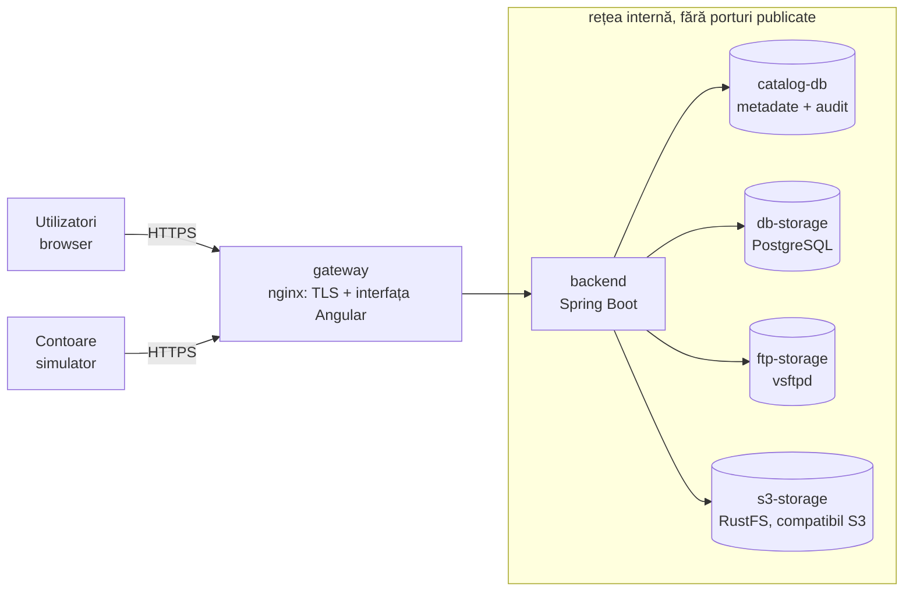

# FileGrid PPC

Punctul unic de intrare pentru fișierele din teren ale Rețele Electrice România: citiri de contor, înregistrări de avarie,
documente de racordare și video-uri de la inspecțiile cu drona. FileGrid decide, pe baza unei **politici per categorie**,
în ce storage (bază de date, FTP sau S3) se scrie fiecare fișier, verifică integritatea lui și măsoară tot ce se întâmplă.

## Pornire (o singură comandă)

Singura cerință este **Docker** (Docker Desktop pe Windows/macOS sau Docker Engine + Compose v2 pe Linux).
Nu e nevoie de Java, Maven sau Node: totul se compilează în containere.

| Sistem | Comandă |
|---|---|
| Windows (PowerShell) | `.\start.ps1` |
| Linux / macOS / Git Bash | `./start.sh` |

Dacă PowerShell refuză scriptul: `powershell -ExecutionPolicy Bypass -File .\start.ps1`.

Apoi deschide **https://localhost:8443**. Certificatul e self-signed, așa că browserul afișează un avertisment pe care trebuie să-l accepți.
Prima pornire durează câteva minute, cât se descarcă imaginile și dependențele.

La prima rulare, scriptul creează fișierul `.env` cu parole și chei **generate aleator**. Fișierul nu intră în git.
Păstrează-l: fără `FILEGRID_ENCRYPTION_KEY`, documentele de racordare deja criptate nu mai pot fi citite.

```bash
docker compose ps                 # starea serviciilor
docker compose logs -f backend    # log-urile aplicației
docker compose down               # oprește (datele rămân în volume)
docker compose down -v            # oprește și ȘTERGE toate datele
```

## Arhitectură



| Serviciu | Rol |
|---|---|
| `gateway` | Singurul punct expus în exterior (HTTPS, port 8443). Servește interfața și face proxy pe `/api` fără buffering. |
| `backend` | Aplicația FileGrid: politici, streaming către storage, SHA-256, criptare, idempotență, metrici. |
| `catalog-db` | Metadatele fișierelor și jurnalul de audit. E **separat** de storage-ul DB, ca acel storage să poată cădea fără să oprească restul. |
| `db-storage` | Storage de tip bază de date (PostgreSQL, `bytea`). |
| `ftp-storage` | Storage FTP. |
| `s3-storage` | Storage S3 (RustFS). LocalStack cere cont din martie 2026 și nu persistă datele în varianta gratuită. |

### Structura repository-ului

```
backend/                     Spring Boot 4 (Java 25)
  src/main/java/ro/ppc/filegrid/
    config/                  politica per categorie (FileGridProperties, CategoryPolicy)
    storage/                 S3StorageBackend, FtpStorageBackend, DatabaseStorageBackend, StorageRegistry
    service/                 FileService (fluxul central), criptare, bulkhead, metrici, audit
    web/                     API REST
  src/main/resources/db/migration/   schema catalogului (Flyway)
frontend/                    Angular 22 + configurația nginx a gateway-ului
config/filegrid-policies.yml politica per categorie (se modifică fără cod)
docker-compose.yml           tot sistemul
docker-compose.dev.yml       doar pentru dezvoltare locală (expune storage-urile pe 127.0.0.1)
```

## Politica per categorie

Politica e în [config/filegrid-policies.yml](config/filegrid-policies.yml). O modifici și rulezi `docker compose restart backend`,
fără rebuild și fără modificarea codului. La pornire, backend-ul validează politica (fiecare categorie trebuie să aibă una,
iar limitele trebuie să fie compatibile cu storage-ul ales) și o afișează în log.

| Categorie | Storage (ipoteza de pornire) | Garanții configurate |
|---|---|---|
| Citiri contoare | DATABASE | `Idempotency-Key` obligatoriu, max 64 KB |
| Înregistrări de avarie | FTP | max 20 MB, max 40 scrieri simultane |
| Documente de racordare | FTP | criptare AES-256-GCM, jurnal de audit |
| Video-uri dronă | S3 | max 5 GB, max 6 scrieri simultane |

Alocarea e o ipoteză de pornire. Metricile per categorie și storage (vezi mai jos) trebuie s-o confirme sau s-o schimbe.

## Cum sunt acoperite cerințele

| Cerință (tema) | Implementare |
|---|---|
| Fișierul recuperat e identic și FileGrid poate demonstra asta | SHA-256 calculat în flux la upload; la download hash-ul se recalculează pe parcurs. `POST /api/files/{id}/verify` recitește fișierul din storage și compară hash-urile (butonul „Verifică” din interfață). |
| Un fișier corupt e detectat la recuperare | La download, ultimul bloc (64 KB) e trimis doar după verificarea hash-ului. Un fișier corupt nu ajunge niciodată complet la client, iar incidentul apare în log și în metrica `filegrid_integrity_failures_total`. |
| Nicio citire de contor pierdută sau dublată | `Idempotency-Key` per citire, plus index unic `(category, idempotency_key)` în catalog. Testat: 50 de reîncercări simultane au produs o singură înregistrare. |
| Date personale protejate și auditabile | Documentele de racordare sunt criptate AES-256-GCM **înainte** de storage, deci pe FTP stau doar bytes criptați. Orice upload, download sau verificare se scrie în `file_access_log`. |
| Storage-urile nu sunt accesibile din exterior | Rețea Docker `internal: true`. Singurul port publicat e HTTPS-ul gateway-ului. |
| Trafic extern criptat | TLS la gateway (certificat generat la prima pornire, nu stocat în repository). |
| Nicio parolă în repository | Totul vine din `.env`, generat aleator de scriptul de start. |
| Căderea unui storage nu oprește restul | Catalog separat, storage-uri conectate „lazy”, readiness dependent doar de catalog. Un storage căzut dă `503` + `Retry-After` doar categoriilor care îl folosesc. |
| Fișiere > 1 GB fără creșterea resurselor | Upload ca body brut, stream-uit direct socket → storage (fără multipart, fără fișiere temporare). Testat: 600 MB cu memoria backend-ului constantă (~290 MB, limita containerului fiind 768 MB). |
| Vârf 10x într-o categorie nu le afectează pe celelalte | Bulkhead per categorie (`max-concurrent-uploads`). Peste limită, cererile primesc `429` + `Retry-After`. |
| Capacitate prin instanțe noi | Backend fără stare. `docker compose up -d --scale backend=3` e preluat automat de gateway. |
| Latență p50/p95/p99, throughput, rată de erori per categorie și storage | Metrici Micrometer/Prometheus: `filegrid_storage_operation_seconds` (histogramă), `filegrid_storage_transferred_bytes`, etichete `category`, `storage`, `outcome`. |
| Urmărirea unei operații | `X-Request-Id` generat de gateway, prezent în log-uri, în răspuns și în jurnalul de audit. |

## API

| Metodă | Endpoint | Descriere |
|---|---|---|
| `POST` | `/api/files?category=…&name=…[&region=…&description=…]` | Upload. Body-ul **este** fișierul. Header opțional `Idempotency-Key`. |
| `GET` | `/api/files?category=&q=&region=&page=&size=` | Căutare. |
| `GET` | `/api/files/{id}` | Metadate. |
| `GET` | `/api/files/{id}/content` | Download (header `X-FileGrid-SHA256`). |
| `POST` | `/api/files/{id}/verify` | Demonstrația de integritate. |
| `POST` | `/api/meter-readings` | Citire de contor. Header-e: `X-Meter-Id`, `Idempotency-Key`, opțional `X-Region` (codul județului, ex. `CT`). |
| `GET` | `/api/system/status` | Starea storage-urilor și politicile active. |

Coduri relevante pentru clienții automați: `201` înseamnă stocat, iar `200` cu `"duplicate": true` înseamnă că fișierul exista deja.
La `409`, `429` sau `503` clientul **reîncearcă cu aceeași cheie**. Celelalte coduri `4xx` nu se reîncearcă.

```bash
# citire de contor (repetă comanda: a doua oară primești 200 + duplicate=true)
curl -k -X POST https://localhost:8443/api/meter-readings \
  -H "Content-Type: application/json" -H "X-Meter-Id: CT-000123" \
  -H "Idempotency-Key: 2026-11-14T13:00:00Z" -H "X-Region: CT" \
  -d '{"kWh":[0.21,0.19,0.22,0.25]}'

# upload fișier
curl -k -X POST "https://localhost:8443/api/files?category=DRONE_VIDEO&name=inspectie.mp4&region=AR" \
  -H "Content-Type: video/mp4" --data-binary @inspectie.mp4
```

## Dezvoltare locală

Pentru dezvoltare cu IntelliJ și `ng serve`, cu reîncărcare rapidă, instalează **JDK 25** și **Node 24 LTS**.

```bash
# 1. doar storage-urile, cu porturile publicate pe 127.0.0.1
docker compose -f docker-compose.yml -f docker-compose.dev.yml up -d catalog-db db-storage ftp-storage s3-storage

# 2. backend pe http://localhost:8080 (citește automat ../.env și ../config/filegrid-policies.yml)
cd backend && ./mvnw spring-boot:run          # sau Run pe FilegridApplication din IntelliJ

# 3. frontend pe http://localhost:4200 (proxy /api -> localhost:8080)
cd frontend && npm install && npm start
```

Consola RustFS (obiectele din bucket) e disponibilă în modul dev la http://localhost:9001.
Metricile backend-ului pornit local sunt la http://localhost:8080/actuator/prometheus.

## Demonstrații rapide

```bash
# un storage cade: celelalte categorii merg în continuare, iar categoria afectată primește 503 + Retry-After
docker compose stop ftp-storage
docker compose start ftp-storage

# corupere deliberată a unui fișier direct pe FTP; „Verifică” din interfață arată ✗ CORUPT
docker compose exec ftp-storage sh -c "printf X | dd of=/ftp/data/<storage_key> bs=1 seek=1000 conv=notrunc"

# metricile (din interiorul rețelei; actuator-ul nu e expus în exterior)
docker compose exec backend wget -qO- http://127.0.0.1:8080/actuator/prometheus | grep filegrid_
```

## Ce urmează

- [ ] **Autentificare** (Spring Security + OIDC/Keycloak): roluri per categorie (teren, dispecerat, racordări), credențiale proprii pentru contoare.
- [ ] **Simulatorul de contoare**, cu volum configurabil (zi normală vs. vârf) și reîncercări pe `409`/`429`/`503` cu aceeași cheie.
- [ ] **Upload reluabil pentru video** (chunk-uri → S3 multipart, ex. protocolul tus), plus test pe rețea degradată (toxiproxy / `tc netem`).
- [ ] **Observabilitate**: Prometheus, Grafana, Loki, Tempo (OpenTelemetry), dashboard per categorie și storage, alerte pe cerințele din tabelul 2.1.
- [ ] **Statistici și interpretare** (secțiunea 5 din temă): storage potrivit per categorie, zi normală vs. vârf, anomalii în citiri, zone cu avarii.
- [ ] **Kubernetes** (manifeste + HPA) și **teste de încărcare** (k6 / Gatling).
