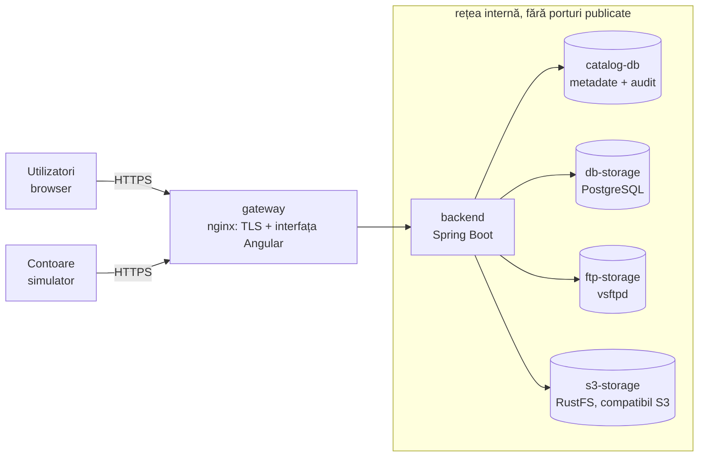

# FileGrid PPC

Punctul unic de intrare pentru fișierele din teren ale Rețele Electrice România: citiri de contor, înregistrări de avarie,
documente de racordare și video-uri de la inspecțiile cu drona. FileGrid decide, pe baza unei **politici per categorie**,
în ce storage (bază de date, FTP sau S3) se scrie fiecare fișier, verifică integritatea lui și măsoară tot ce se întâmplă.

## Pornire (o singură comandă)

Singura cerință este **Docker** (Docker Desktop pe Windows/macOS sau Docker Engine + Compose v2 pe Linux).
Nu e nevoie de Java, Maven sau Node: totul se compilează în containere.

| Sistem | Comandă |
|---|---|
| Windows (PowerShell) | `.\start.ps1` |
| Linux / macOS / Git Bash | `./start.sh` |

Dacă PowerShell refuză scriptul: `powershell -ExecutionPolicy Bypass -File .\start.ps1`.

Apoi deschide **https://localhost:8443**. Certificatul e self-signed, așa că browserul afișează un avertisment pe care trebuie să-l accepți.
Prima pornire durează câteva minute, cât se descarcă imaginile și dependențele.

La prima rulare, scriptul creează fișierul `.env` cu parole și chei **generate aleator**. Fișierul nu intră în git.
Păstrează-l: fără `FILEGRID_ENCRYPTION_KEY`, documentele de racordare deja criptate nu mai pot fi citite.
La rulările următoare scriptul adaugă doar valorile care lipsesc.

### Conturi

Parolele sunt în `.env` (`PASSWORD_ADMIN`, `PASSWORD_DISPECER`, `PASSWORD_TEREN`, `PASSWORD_RACORDARI`) și pot fi schimbate acolo.

| Cont | Rol | Poate încărca | Poate vedea |
|---|---|---|---|
| `dispecer` | DISPECERAT | înregistrări de avarie | avarii, video-uri, citiri de contor |
| `teren` | TEREN | avarii, video-uri | avarii, video-uri |
| `racordari` | RACORDARI | documente de racordare | documente de racordare |
| `admin` | ADMIN | avarii, video-uri | tot, **mai puțin** documentele de racordare |

Conturile sunt în [config/filegrid-users.yml](config/filegrid-users.yml), iar drepturile fiecărui rol pe categorii
(`read-roles`, `write-roles`) în [config/filegrid-policies.yml](config/filegrid-policies.yml).

### Adrese utile

| Adresă | Ce este |
|---|---|
| https://localhost:8443 | aplicația |
| http://localhost:8025 | căsuța de e-mail a echipei (Mailpit), unde sosesc alertele |
| http://localhost:9090 | Prometheus (metrici, starea alertelor) |
| http://localhost:9093 | Alertmanager |
| https://localhost:8444 | aplicația printr-o rețea degradată (doar cu profilul `degraded`, vezi mai jos) |

Adresele de observabilitate sunt publicate doar pe `127.0.0.1`.

```bash
docker compose ps                 # starea serviciilor
docker compose logs -f backend    # log-urile aplicației
docker compose down               # oprește (datele rămân în volume)
docker compose down -v            # oprește și ȘTERGE toate datele
```

## Arhitectură



| Serviciu | Rol |
|---|---|
| `gateway` | Singurul punct expus în exterior (HTTPS, port 8443). Servește interfața și face proxy pe `/api` fără buffering. |
| `backend` | Aplicația FileGrid: politici, streaming către storage, SHA-256, criptare, idempotență, metrici. |
| `catalog-db` | Metadatele fișierelor și jurnalul de audit. E **separat** de storage-ul DB, ca acel storage să poată cădea fără să oprească restul. |
| `db-storage` | Storage de tip bază de date (PostgreSQL, `bytea`). |
| `ftp-storage` | Storage FTP. |
| `s3-storage` | Storage S3 (RustFS). LocalStack cere cont din martie 2026 și nu persistă datele în varianta gratuită. |
| `simulator` | Contoarele inteligente simulate. Trimit citiri prin gateway, ca orice client extern. |
| `prometheus`, `alertmanager`, `mailpit` | Colectarea metricilor, evaluarea regulilor de alertă și livrarea alertelor pe e-mail. |
| `bad-network` | Opțional (profil `degraded`): legătură cu latență și pierdere de pachete în fața gateway-ului. |

### Structura repository-ului

```
backend/                     Spring Boot 4 (Java 25)
  src/main/java/ro/ppc/filegrid/
    config/                  politica per categorie (FileGridProperties, CategoryPolicy)
    storage/                 S3StorageBackend, FtpStorageBackend, DatabaseStorageBackend, StorageRegistry
    service/                 FileService (fluxul central), UploadSessionService (upload reluabil), criptare, bulkhead, audit
    security/                login, sesiune, chei de contor, drepturi per categorie
    web/                     API REST
  src/main/resources/db/migration/   schema catalogului (Flyway)
frontend/                    Angular 22 + configurația nginx a gateway-ului
simulator/                   simulatorul de contoare (Java, fără dependențe)
observability/               reguli de alertă Prometheus, configurarea Alertmanager
tools/bad-network/           legătura degradată pentru teste (tc netem)
config/filegrid-policies.yml politica per categorie (se modifică fără cod)
config/filegrid-users.yml    conturi și roluri
config/simulator.properties  volumul simulatorului (se aplică din mers)
config/storm.properties      furtuna de avarii (ritm, durată, zone)
docker-compose.yml           tot sistemul
docker-compose.dev.yml       doar pentru dezvoltare locală (expune storage-urile pe 127.0.0.1)
```

## Politica per categorie

Politica e în [config/filegrid-policies.yml](config/filegrid-policies.yml). O modifici și rulezi `docker compose restart backend`,
fără rebuild și fără modificarea codului. La pornire, backend-ul validează politica (fiecare categorie trebuie să aibă una,
iar limitele trebuie să fie compatibile cu storage-ul ales) și o afișează în log.

| Categorie | Storage (ipoteza de pornire) | Garanții configurate |
|---|---|---|
| Citiri contoare | DATABASE | `Idempotency-Key` obligatoriu, max 64 KB |
| Înregistrări de avarie | FTP | max 20 MB, max 40 scrieri simultane |
| Documente de racordare | FTP | criptare AES-256-GCM, jurnal de audit |
| Video-uri dronă | S3 | max 5 GB, max 6 scrieri simultane |

Alocarea e confirmată de măsurătoarea comparativă din pagina „Statistici” (vezi „Statistici” mai jos).

FTP-ul păstrează deschise până la 80 de conexiuni și le refolosește (`filegrid.storage.ftp.max-connections`), iar serverul FTP
are 400 de porturi pentru transferuri. La pornire, backend-ul avertizează dacă suma scrierilor simultane permise categoriilor
de pe FTP depășește numărul de conexiuni, pentru că atunci o categorie le-ar putea ocupa pe toate la vârf.

## Cum sunt acoperite cerințele

| Cerință (tema) | Implementare |
|---|---|
| Fișierul recuperat e identic și FileGrid poate demonstra asta | SHA-256 calculat în flux la upload; la download hash-ul se recalculează pe parcurs. `POST /api/files/{id}/verify` recitește fișierul din storage și compară hash-urile (butonul „Verifică” din interfață). |
| Un fișier corupt e detectat la recuperare | La download, ultimul bloc (64 KB) e trimis doar după verificarea hash-ului. Un fișier corupt nu ajunge niciodată complet la client, iar incidentul apare în log și în metrica `filegrid_integrity_failures_total`. |
| Nicio citire de contor pierdută sau dublată | `Idempotency-Key` per citire, plus index unic `(category, idempotency_key)` în catalog. Contoarele păstrează citirea și reîncearcă până la confirmare. Testat: storage-ul citirilor oprit un minut, 229 de citiri ținute în așteptare, toate livrate la revenire, 0 pierdute, 0 dublate. |
| Simulator de contoare cu volum configurabil | Serviciul `simulator`; `config/simulator.properties` se aplică din mers (`profile=peak` înmulțește volumul cu `peak-multiplier`). |
| Date personale protejate și auditabile | Documentele de racordare sunt criptate AES-256-GCM **înainte** de storage, deci pe FTP stau doar bytes criptați. Numele și descrierea lor sunt criptate și în catalog (`enc1:…`); căutarea merge în continuare, prin amprente HMAC ale secvențelor de 3 caractere (`search_tokens`), fără să păstreze textul. Log-ul gateway-ului nu mai conține parametrii URL-ului, deci nici numele fișierelor. Doar rolul RACORDARI le poate accesa. Orice upload, download, verificare sau acces refuzat se scrie în `file_access_log`, cu numele utilizatorului. |
| Storage-urile nu sunt accesibile din exterior | Rețea Docker `internal: true`. Singurul port publicat e HTTPS-ul gateway-ului. |
| Trafic extern criptat | TLS la gateway (certificat generat la prima pornire, nu stocat în repository). |
| Acces autentificat | Utilizatorii se autentifică cu cont și parolă; sesiunea e un token semnat, ținut într-un cookie `HttpOnly`, `Secure`, `SameSite=Strict`, cu protecție CSRF. Fiecare contor are cheia lui, derivată din `METER_MASTER_KEY` (HMAC-SHA256 pe id-ul contorului). |
| Transferuri finalizate sau reluate pe rețea proastă | Fișierele mari se trimit în bucăți de 5 MB, fiecare cu SHA-256 propriu. La întrerupere, interfața reîncearcă singură și retrimite doar bucata întreruptă; dacă se închide browserul, selectarea aceluiași fișier continuă de unde a rămas. Testat din browser cu 150 ms întârziere, 3% pachete pierdute și conexiunea tăiată 20 s în timpul transferului. Descărcarea se reia și ea: serverul acceptă cereri `Range`, iar interfața continuă singură de la ultimul byte primit (vezi „Descărcare reluabilă”). |
| Statistici și interpretare (secțiunea 5) | Pagina „Statistici”: ce storage se potrivește fiecărei categorii (măsurătoare comparativă), vârf comparat cu normal, anomalii din citiri și avarii pe zone, fiecare cu concluzii în cuvinte. |
| Date personale verificabile la audit | Pagina „Audit” arată jurnalul `file_access_log` celor care au drept de citire pe categoria auditată. |
| Echipa e anunțată când o cerință de business e în pericol | 18 reguli în `observability/prometheus/alerts.yml`, grupate pe rândurile din tabelul 2.1; alertele ajung pe e-mail în mai puțin de un minut, cu cerința afectată și ce e de făcut. |
| Nicio parolă în repository | Totul vine din `.env`, generat aleator de scriptul de start. |
| Căderea unui storage nu oprește restul | Catalog separat, storage-uri conectate „lazy”, readiness dependent doar de catalog. Un storage căzut dă `503` + `Retry-After` doar categoriilor care îl folosesc. |
| Fișiere > 1 GB fără creșterea resurselor | Upload ca body brut sau în bucăți de 5 MB, stream-uit direct socket → storage (fără fișiere temporare); download tot în flux. Testat cu 1,2 GB (vezi „Test cu fișier peste 1 GB”). |
| Vârf 10x într-o categorie nu le afectează pe celelalte | Bulkhead per categorie (`max-concurrent-uploads`). Peste limită, cererile primesc `429` + `Retry-After`. Se demonstrează cu generatorul de furtună (vezi mai jos). |
| Capacitate prin instanțe noi | Backend fără stare. `docker compose up -d --scale backend=3` e preluat automat de gateway și de Prometheus. Analiza citirilor se împarte între instanțe (`FOR UPDATE SKIP LOCKED`), iar măsurătoarea storage-urilor rulează o singură dată în tot clusterul (lock în PostgreSQL). |
| Latență p50/p95/p99, throughput, rată de erori per categorie și storage | Metrici Micrometer/Prometheus: `filegrid_storage_operation_seconds` (histogramă), `filegrid_storage_transferred_bytes`, etichete `category`, `storage`, `outcome`. |
| Urmărirea unei operații | `X-Request-Id` generat de gateway, prezent în log-ul gateway-ului, în log-urile backend-ului, în răspuns și în jurnalul de audit; log-ul storage-ului se leagă prin id-ul fișierului. |

## Simulatorul de contoare

Pornește odată cu sistemul și trimite continuu citiri (fișiere JSON de 1–50 KB) prin gateway. Volumul se schimbă din
[config/simulator.properties](config/simulator.properties), fără restart:

| Cheie | Rol |
|---|---|
| `meters` | numărul de contoare |
| `interval-seconds` | la câte secunde trimite fiecare contor o citire |
| `profile` | `normal` sau `peak` |
| `peak-multiplier` | de câte ori crește volumul în `peak` |

Cu valorile implicite: 3,3 citiri/s în zi normală și 33 citiri/s la vârf. Starea se vede cu `docker compose logs -f simulator`
(generate, confirmate, reîncercări, în așteptare, pierdute). `docker compose stop simulator` îl oprește.

## Furtună de avarii (vârf de 10 ori)

```bash
docker compose --profile storm run --rm storm
```

Generatorul se autentifică drept `dispecer` și încarcă înregistrări de avarie prin gateway: întâi un minut în ritm normal,
apoi două minute de 10 ori mai des. În paralel, contul `racordari` încarcă documente de racordare într-un ritm constant:
ele stau pe același FTP ca avariile, deci sunt martorul care arată dacă furtuna încetinește alte categorii.
La final afișează, pentru fiecare fază și categorie, câte fișiere au fost stocate, latența p50/p95, câte cereri au primit
`429`/`503` (sunt reîncercate cu aceeași cheie), câte s-au pierdut (trebuie să fie 0) și dacă documentele au fost
încetinite. Simulatorul de contoare rulează și el în paralel, așa că pagina „Statistici” arată apoi efectul vârfului
asupra tuturor categoriilor, iar Prometheus trimite alerta `VarfDeVolum`.

Rezultat măsurat (avarii de 1–4 MB, 6/min → 60/min, documente 12/min): 126 de avarii și 36 de documente stocate,
0 pierdute, 0 respinse; documentele au avut mediana de 29 ms înainte de furtună și 27 ms în timpul ei.

Ritmul, durata, dimensiunea fișierelor (implicit 1–10 MB), zonele lovite de furtună și ritmul documentelor
(`documents-per-minute`, 0 le oprește) se schimbă din [config/storm.properties](config/storm.properties).
Cu valorile implicite, o rulare scrie aproximativ 700 MB pe FTP.

## Statistici

Pagina „Statistici” (conturile `admin` și `dispecer`; rolurile se schimbă cu `filegrid.stats.view-roles`) răspunde la trei întrebări:

| Întrebare | Cum se calculează |
|---|---|
| Ce storage se potrivește fiecărei categorii? | Butonul „Rulează măsurătoarea” (doar `admin`, aproximativ 15 s) scrie, recitește și verifică aceleași fișiere de test pe toate cele trei storage-uri, cu dimensiunea tipică a fiecărei categorii. Cifrele sunt media ultimelor 3 rulări, iar clasamentul folosește mediana (p95 e afișat, dar cu puține fișiere depinde de o singură scriere lentă). Recomandarea alege combinația cea mai rapidă care respectă două reguli: toate cele trei storage-uri rămân folosite (cerință din temă), iar avariile și video-urile nu împart storage-ul, pentru că ambele au vârf după furtuni. Diferențele sub 15% sunt tratate ca egalitate și atunci se păstrează politica actuală. Dedesubt apare și traficul real din interval. |
| Cum s-a comportat sistemul la vârf? | Din catalog, la două scări. Pe minute: un minut e „vârf” dacă are cel puțin de 3 ori volumul median al categoriei. Pe perioade: intervale de 5 minute, jumătăți de oră, ore sau zile, în funcție de intervalul ales („Ultimele 7 zile” compară zile întregi). Se compară volumul, durata p95 și eșecurile perioadei de vârf cu ale unei perioade obișnuite, apoi se verifică dacă celelalte categorii au fost încetinite în aceleași perioade. |
| Ce spun datele despre rețea? | Conținutul fiecărei citiri de contor e analizat în fundal, fără să încetinească ingestia: întreruperi (tensiune 0), tensiune sub 207 V, vârfuri bruște de consum. Rezultă harta avariilor pe județe, zonele cu cele mai multe anomalii, contoarele cu probleme repetate, contoarele care nu mai transmit și zonele cu avarii fără inspecție cu drona. |

Contururile județelor din hartă provin din [click_that_hood](https://github.com/codeforgermany/click_that_hood)
(`romania.geojson`), simplificate și incluse în aplicație, deci harta funcționează și fără internet.

Aceiași indicatori există și în Prometheus, ca serii precalculate în
[observability/prometheus/rules.yml](observability/prometheus/rules.yml): `filegrid:latenta_secunde:p50`/`p95`/`p99`,
`filegrid:operatii_pe_secunda`, `filegrid:bytes_pe_secunda`, `filegrid:rata_erori`, `filegrid:incarcari_pe_minut`,
`filegrid:anomalii_la_mia_de_citiri` și `filegrid:masuratoare_secunde:p95`. Ocuparea conexiunilor FTP se vede în
`filegrid_ftp_connections_in_use`, `filegrid_ftp_connections_idle` și `filegrid_ftp_connections_limit`.

## Audit

Pagina „Audit” apare pentru conturile care pot citi o categorie cu `audit-access: true` (implicit `racordari`).
Arată cine a încărcat, descărcat sau verificat fiecare document, când, de la ce adresă și cu ce rezultat, plus
încercările de acces refuzate. Id-ul cererii din tabel e același `X-Request-Id` din log-uri.

## Descărcare reluabilă

`GET /api/files/{id}/content` acceptă `Range: bytes=…` și răspunde cu `206`, `Accept-Ranges` și `ETag` (SHA-256 al fișierului).
Integritatea se verifică și pe intervale: la fișierele încărcate în bucăți, fiecare bucată livrată e comparată cu SHA-256 al ei.
În Chrome și Edge, „Descarcă” scrie fișierul direct pe disc și, la întrerupere, continuă singur de la ultimul byte primit.
În celelalte browsere descărcarea e cea obișnuită a browserului, care poate fi reluată din lista lui de descărcări.

Testat cu Chromium prin rețeaua degradată (100 ms întârziere, 1% pachete pierdute, 8 Mbit/s), pe un video de 12 MB încărcat
în bucăți: conexiunea a fost tăiată de două ori (`docker compose restart bad-network`), la 28% și la 61%. De fiecare dată
interfața a afișat „Conexiune instabilă — reiau automat” și a continuat de la 30%, respectiv 62%, nu de la zero;
fișierul salvat a avut SHA-256 identic cu cel stocat.

```bash
curl -sk -b jar -C - -o inspectie.mp4 https://localhost:8443/api/files/<id>/content
```

## Test cu fișier peste 1 GB

Un video de 1,2 GB (1 258 291 200 bytes) încărcat ca din interfață, în 240 de bucăți de 5 MB, pe S3:

| Măsurătoare | Rezultat |
|---|---|
| Upload | 98 s, SHA-256 calculat de server identic cu cel local |
| Download | 13 s, SHA-256 al fișierului descărcat identic |
| Memoria backend-ului | constantă pe tot transferul (630 MiB, cât avea și înainte); limita containerului e 768 MiB |

Memoria nu depinde de dimensiunea fișierului: datele trec prin backend în blocuri de 64 KB, fără să fie ținute
în memorie sau scrise în fișiere temporare. Java are voie să folosească 55% din limita containerului pentru heap
(`-XX:MaxRAMPercentage=55` în [backend/Dockerfile](backend/Dockerfile)); restul rămâne pentru memoria nativă
(clase, cod compilat, conexiuni), ca procesul să nu atingă limita containerului.

## Alerte

Regulile sunt în [observability/prometheus/alerts.yml](observability/prometheus/alerts.yml). Câteva exemple:

| Cerința din tabelul 2.1 | Alerte |
|---|---|
| Nicio citire pierdută sau dublată | storage-ul citirilor căzut, citiri respinse, flux oprit, retransmisii masive |
| Avarii disponibile imediat | storage căzut, încărcare lentă (p95 > 5 s), cereri respinse |
| Date personale protejate și auditabile | criptare sau audit dezactivate din politică, încercări de acces neautorizat |
| Transfer rezistent pe conexiuni instabile | transferuri blocate, bucăți întrerupte des, storage căzut |

Demonstrație: `docker compose stop db-storage`, apoi în cel mult un minut apare e-mailul la http://localhost:8025;
după `docker compose start db-storage` sosește și mesajul „REZOLVAT”.

## Rețea degradată

```bash
docker compose --profile degraded up -d bad-network     # pornește legătura proastă
docker compose --profile degraded stop bad-network      # taie conexiunea (și o repornește cu start)
```

Aplicația se deschide apoi la https://localhost:8444. Implicit: 300 ms întârziere, 5% pachete pierdute, 8 Mbit/s;
valorile se schimbă cu `NETEM_DELAY`, `NETEM_JITTER`, `NETEM_LOSS`, `NETEM_RATE`.

## Urmărirea unei operații

Orice răspuns are header-ul `X-Request-Id`. Cu el se găsește tot drumul cererii:

```bash
docker compose logs gateway backend | grep <id>
```

Gateway-ul arată cererea, durata și instanța de backend; backend-ul arată id-ul fișierului, storage-ul și cheia din storage;
log-ul storage-ului (`docker compose logs ftp-storage | grep <id-fișier>`) arată scrierea; `file_access_log.request_id` leagă intrarea de audit.

## API

Toate endpoint-urile cer autentificare: cookie de sesiune (`POST /api/auth/login`) pentru utilizatori, `X-Meter-Key` pentru contoare.

| Metodă | Endpoint | Descriere |
|---|---|---|
| `POST` | `/api/auth/login`, `/api/auth/logout`; `GET /api/auth/session` | Autentificare. |
| `POST` | `/api/uploads` → `PUT /api/uploads/{id}/parts/{n}` → `POST /api/uploads/{id}/complete` | Upload reluabil, în bucăți. |
| `POST` | `/api/files?category=…&name=…[&region=…&description=…]` | Upload. Body-ul **este** fișierul. Header opțional `Idempotency-Key`. |
| `GET` | `/api/files?category=&q=&region=&page=&size=` | Căutare. |
| `GET` | `/api/files/{id}` | Metadate. |
| `GET` | `/api/files/{id}/content` | Download (header `X-FileGrid-SHA256`); acceptă `Range`. |
| `GET` | `/api/audit?action=&q=&page=&size=` | Jurnalul de audit. |
| `GET` | `/api/stats?hours=` | Statistici și concluzii pentru ultimele ore. |
| `POST` | `/api/stats/benchmark` | Măsurătoarea comparativă a storage-urilor. |
| `POST` | `/api/files/{id}/verify` | Demonstrația de integritate. |
| `POST` | `/api/meter-readings` | Citire de contor. Header-e: `X-Meter-Id`, `X-Meter-Key`, `Idempotency-Key`, opțional `X-Region` (codul județului, ex. `CT`). |
| `GET` | `/api/system/status` | Starea storage-urilor și politicile active. |

Coduri relevante pentru clienții automați: `201` înseamnă stocat, iar `200` cu `"duplicate": true` înseamnă că fișierul exista deja.
La `409`, `429` sau `503` clientul **reîncearcă cu aceeași cheie**. Celelalte coduri `4xx` nu se reîncearcă.

```bash
# autentificare din linia de comandă (cookie + token CSRF), apoi upload
curl -sk -c jar -b jar https://localhost:8443/api/auth/session -o /dev/null
XSRF=$(grep XSRF-TOKEN jar | awk '{print $7}')
curl -sk -c jar -b jar -X POST https://localhost:8443/api/auth/login -H "X-XSRF-TOKEN: $XSRF" \
  -H "Content-Type: application/json" -d '{"username":"teren","password":"<PASSWORD_TEREN>"}'
curl -sk -b jar -X POST "https://localhost:8443/api/files?category=DRONE_VIDEO&name=inspectie.mp4&region=AR" \
  -H "X-XSRF-TOKEN: $XSRF" -H "Content-Type: video/mp4" --data-binary @inspectie.mp4
```

## Dezvoltare locală

Pentru dezvoltare cu IntelliJ și `ng serve`, cu reîncărcare rapidă, instalează **JDK 25** și **Node 24 LTS**.

```bash
# 1. doar storage-urile, cu porturile publicate pe 127.0.0.1
docker compose -f docker-compose.yml -f docker-compose.dev.yml up -d catalog-db db-storage ftp-storage s3-storage

# 2. backend pe http://localhost:8080 (citește automat ../.env și ../config/filegrid-policies.yml)
cd backend && ./mvnw spring-boot:run          # sau Run pe FilegridApplication din IntelliJ

# 3. frontend pe http://localhost:4200 (proxy /api -> localhost:8080)
cd frontend && npm install && npm start
```

Consola RustFS (obiectele din bucket) e disponibilă în modul dev la http://localhost:9001.
Metricile backend-ului pornit local sunt la http://localhost:8080/actuator/prometheus.

## Demonstrații rapide

```bash
# un storage cade: celelalte categorii merg în continuare, iar categoria afectată primește 503 + Retry-After
docker compose stop ftp-storage
docker compose start ftp-storage

# corupere deliberată a unui fișier direct pe FTP; „Verifică” din interfață arată ✗ CORUPT
docker compose exec ftp-storage sh -c "printf X | dd of=/ftp/data/<storage_key> bs=1 seek=1000 conv=notrunc"

# metricile (din interiorul rețelei; actuator-ul nu e expus în exterior)
docker compose exec backend wget -qO- http://127.0.0.1:8080/actuator/prometheus | grep filegrid_
```

## Ce urmează

- [ ] **Grafice** (Grafana) pentru latență p50/p95/p99, throughput și erori; **căutare centralizată în log-uri** (Loki) și trasare pe pași (Tempo).
- [ ] Memorie persistentă pentru simulator (citirile în așteptare se pierd dacă simulatorul însuși e oprit).
- [ ] **Kubernetes** (manifeste + HPA) și **teste de încărcare** (k6 / Gatling).
